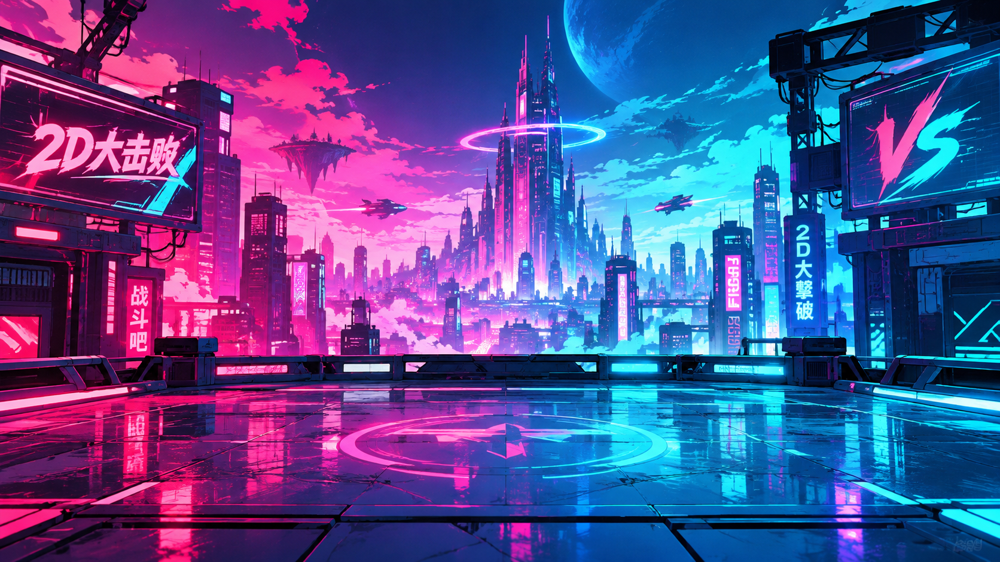

# 2D大击败 / 2DFight Arena

[](https://github.com/Wang100426/2d-da-jibai/stargazers) [](https://github.com/Wang100426/2d-da-jibai/network/members) [](https://github.com/Wang100426/2d-da-jibai/issues) [](https://github.com/Wang100426/2d-da-jibai/releases)

**中文** | [English](#2dfight-arena)

<p align="center"></p>

《2D大击败》是一款赛博风 2D 战斗竞技场游戏，技术栈为 **Flask + 原生 HTML/CSS/TypeScript**，桌面版用 **Electron** 封装、**PyInstaller** 打包后端。选择英雄，在霓虹废墟中迎战敌潮、挑战 AI，或与局域网好友并肩作战。

游戏支持中文 / English / 日本語三种界面，英文名为 **2DFight Arena**，日文名为 **2D大撃破**。当前版本 **2.1.0**。

## 目录

- [特性总览](#特性总览)
- [游戏模式](#游戏模式)
- [英雄](#英雄)
- [装备系统](#装备系统)
- [地图](#地图)
- [操作](#操作)
- [运行与构建](#运行与构建)
- [项目结构](#项目结构)
- [开发指南](#开发指南)
- [常见问题](#常见问题)

## 特性总览

| | |
| --- | --- |
| **英雄** | 10 位，7 位免费 + 3 位金币解锁，每位都有独立被动与三技能升阶 |
| **地图** | 7 张赛博场景，每张带随机事件与独立地形 |
| **模式** | 单机肉鸽 / 人机对抗（先赢四分）/ 局域网联机 |
| **养成** | 金币结算、英雄商店、存档导入导出、装备抽取与装配 |
| **装备** | 5 个位置 × 5 种品质，属性直接带进战斗 |
| **语言** | 简体中文 / English / 日本語，三份语言包键结构一致 |
| **画面** | 全站点击与过场动画、启动画面、战斗渲染优化 |

## 游戏模式

- **单机肉鸽**：挑战不断增强的敌潮，每波结束后选择战斗强化。击败敌人可获得技能经验，升级时可强化英雄技能；战斗支持暂停。
- **人机对抗**：与 AI 一对一较量，先赢得四分获胜。每回合结束后可选择强化，十秒后开始下一回合。
- **局域网联机**：创建或加入房间，与同一局域网的玩家共同战斗。玩家位置、玩家间攻击伤害、生命、能量和控制效果由 Flask 房间服务同步。
- **模式选择页**（`/mode`）：主页左侧的方形入口进入，与选人页同款的侧栏 + 详情布局，右下角「选定」后返回主页。「开始游戏」会按你选的模式跳转：肉鸽 → 选人，联机 → 大厅，人机 → 人机选人。
- **战场过渡页**：使用全屏战场概览图，展示地图和特殊事件，左下角显示出战角色；淡入淡出与右下角加载动画持续 5 秒。

### 经济与存档

- **金币结算**：单机肉鸽每局结束（阵亡，或中途退出返回选人页）按「到达波次 × 10 + 击杀数 × 1」结算，单局上限 500；人机对抗与联机不结算。
- **英雄商店**：金币可解锁江湖客（1000）、滑板小子（1000）、篮球少年（1500）。商店入口在主页与选人页右上角的金币胶囊。
- **存档管理**：主页右上角的「存档管理」可查看金币与已解锁英雄、导出 JSON 备份、导入覆盖存档，以及两步确认后重置存档。

## 英雄

英雄唯一数据源是 `app.py` 的 `HEROES` 列表。

| 英雄 | 定位 | 普攻距离 | 解锁 |
| --- | --- | --- | --- |
| 霓虹拳王 `volt` | 突进斗士 | 95 | 免费 |
| 苔藓守卫 `moss` | 荆棘壁垒 | 150 | 免费 |
| 月蚀术士 `luna` | 月相炮手 | 300 | 免费 |
| 科技男 `tech` | 全息游击手 | 330 | 免费 |
| 琵琶女 `pipa` | 弦音控场师 | 200 | 免费 |
| 电音人 `volt2` | 声浪打击者 | 300 | 免费 |
| 樱花少女 `sakura` | 花火术士 | 250 | 免费 |
| 江湖客 `jianghu` | 独行剑客 | 150 | 1000 金币 |
| 滑板小子 `skater` | 街头滑手 | 100 | 1000 金币 |
| 篮球少年 `bball` | 球场射手 | 200 | 1500 金币 |

**按键约定**：所有英雄统一 **Q = 大招、E = 一技能、R = 二技能**。`skills` 列表顺序即 Q/E/R。

### 英雄被动

每位英雄都有一个被动技能，在选人页展示。数值配置在 `app.py` 对应英雄的 `passive` 字段：

| 英雄 | 被动 | 效果 |
| --- | --- | --- |
| 霓虹拳王 | 突破极限 | 每普攻 1 次，攻速 +0.05 次/秒，对该英雄取消攻速上限 |
| 苔藓守卫 | 苔藓馈赠 | 初始吸血 10%，每次击杀 +1% 吸血，对该英雄取消吸血上限 |
| 月蚀术士 | 月相扩张 | 每次击杀普攻范围 +5（无上限）；每击杀 20 次，下一次大招额外降落一颗陨石 |
| 科技男 | 超频协议 | 每击杀 20 次，**层数 +1（永久叠加）**：二技能每层多 1 次往返、一技能每层多发射 1 块击退平板、大招每层伤害 +20% |
| 琵琶女 | 弦音不绝 | 每通过狂舞击杀 3 次或小兵击杀 10 次后，**十面埋伏此后每次施放都多召唤 1 名小兵**（可叠加层数）；大招狂舞时间 +1 秒 |
| 电音人 | 共鸣 | 被技能击中 3 次的敌人陷入 3 秒狂舞；对狂舞中的敌人伤害 +50% |
| 樱花少女 | 引燃 | 技能命中即引燃目标，每秒造成自身最大生命值 5% 的伤害，持续 3 秒；灼烧期间再次被技能命中，每秒伤害 +10%（最高 4 倍）并刷新持续时间 |
| 江湖客 | 一剑封喉 | 敌方生命值每降低 1%，每次攻击该单位 +0.6% 概率直接斩杀 |
| 滑板小子 | 越滑越快 | 每次普攻永久 +0.5% 移速；普攻附加（当前移速 / 基础移速 − 1）× 基础伤害的额外伤害 |
| 篮球少年 | 弹夹射手 | 普攻改为投篮，弹夹初始 10 发，每击杀 5 个敌人上限 +1，5 发/秒射出，空弹时无法普攻 |

月蚀术士的额外陨石落在**施法范围内不是最近的那个敌人**身上；范围内没有第二个目标则不投放。

### 新英雄技能速查

**滑板小子**（近战，100）

| 键 | 技能 | 效果 | 2 阶 | 3 阶 |
| --- | --- | --- | --- | --- |
| Q | 炫酷滑板 | 滑板当回旋镖扔出，穿透建筑，来回两段都造成伤害和 1 秒眩晕；期间自身移速 −30% | 距离 350 → 500 | 自身不减速，额外向最近 2 个敌人各扔一块滑板 |
| E | 坚硬滑板 | 砸地，对 200 范围内敌人造成伤害并减速 20% 持续 3 秒 | 减速 20% → 30% | 范围 200 → 270 |
| R | 滑板能飞 | 5 秒内移速 +30%，其他技能锁定；空格改为无敌起跳 + 额外 20% 加速，1 秒后砸地造成伤害和强力击退 | 5 秒 → 7 秒 | 砸地额外眩晕 1 秒 |

**篮球少年**（远程，200）

| 键 | 技能 | 效果 | 2 阶 | 3 阶 |
| --- | --- | --- | --- | --- |
| Q | 快速过人 | 0.5 秒内连续穿透最近 5 个敌人（无敌），1 秒后造成大额伤害 | 命中同时眩晕 1 秒 | 穿透目标 5 → 10 个 |
| E | 三步上篮 | 1 秒内向前冲刺最多 350（无敌，受建筑阻挡），终点造成伤害并眩晕 1 秒 | 眩晕 +1 秒 | 连续 2 次冲刺和攻击 |
| R | 投篮高手 | 3 秒内弹夹视为无限 | 射速 5/秒 → 10/秒 | 时长 +2 秒，普攻无视距离（不无视建筑） |

**樱花少女**（远程，250）

| 键 | 技能 | 效果 | 2 阶 | 3 阶 |
| --- | --- | --- | --- | --- |
| Q | 樱花之歌 | 3 秒内移速 +50% 且免疫伤害，撞到的敌人被击退并受伤 | +1 秒 | 撞到的敌人同时被施加樱花风暴 |
| E | 夏日祭 | 在普攻范围展开祭典区域，范围内敌人每 0.5 秒受一次伤害，持续 3 秒 | +1 秒 | 每 0.25 秒跳一次 |
| R | 樱花风暴 | 在最近敌人处生成半径 200 的风暴，0.5 秒把敌人卷向中心，随后伤害并眩晕 1 秒 | 眩晕后额外减速 50% 持续 3 秒 | 吸引时间延长至 1 秒 |

**江湖客**（近战，150）

| 键 | 技能 | 效果 | 2 阶 | 3 阶 |
| --- | --- | --- | --- | --- |
| Q | 侠客行 | 无敌，每 0.5 秒向半径 300 内最近的敌人位移并攻击一次，最多 5 次；不连续命中同一敌人；范围内没敌人立即停止并按位移次数返还冷却 | 每次位移额外眩晕 0.5 秒 | 间隔 0.25 秒、最多 10 次 |
| E | 剑客之刃 | 强化接下来 3 次普攻，伤害 +20% 并吸血 10% | 增伤 → 40% | 吸血 → 25% |
| R | 御剑飞行 | 3 秒内移速 +50%、闪避 +50% | 3 秒 → 5 秒 | 移速 +50% → +100% |

**电音人**（远程，300）

| 键 | 技能 | 效果 | 2 阶 | 3 阶 |
| --- | --- | --- | --- | --- |
| Q | 碟片风暴 | 向最近的敌人连续投出 10 枚追踪唱片，每枚造成伤害与小击退 | 唱片数量 +4 | 唱片伤害 +50% |
| E | 音浪冲击 | 朝移动方向射出音浪，命中造成伤害并击退；撞到建筑原地爆炸造成范围伤害 | 飞行更远（420 → 550） | 穿过建筑，击中 2 个敌人后自爆 |
| R | 低音震荡 | 强化下次普攻，伤害 +50% 并附加 3 秒狂舞（**不计入被动层数**） | 伤害变为 200% | 计入被动层数；若此击叠满 3 层则立即消耗，狂舞延长至 9 秒 |

「同一次施法对同一敌人只记 1 层被动」由 `resonanceCasts` 集合保证——碟片风暴一次扔 10 枚，但每张碟片共用同一个 `castId`，所以对单个敌人只 +1 层。需要 3 次**施法**才能叠满。

## 装备系统

1.9.0 起加入。数据定义在 `player_save.py` 顶部。

| 位置 | 属性 | 白色基础值 | 传说（×3） |
| --- | --- | --- | --- |
| 武器 `weapon` | 攻击 | 5 | 15 |
| 头盔 `helmet` | 防御 | 3 | 9 |
| 护甲 `armor` | 生命上限 | 20 | 60 |
| 靴子 `boots` | 移速 | 5 | 15 |
| 饰品 `accessory` | 能量上限 | 10 | 30 |

| 品质 | 倍率 | 抽取权重 |
| --- | --- | --- |
| 普通 `common` | ×1.0 | 40 |
| 精良 `uncommon` | ×1.5 | 30 |
| 稀有 `rare` | ×2.0 | 20 |
| 史诗 `epic` | ×2.5 | 8 |
| 传说 `legendary` | ×3.0 | 2 |

- **抽取**：`/equipment` 页单抽 **100 金币**，位置与品质随机，数值 = 基础值 × 品质倍率（四舍五入取整）
- **装配**：5 个位置各装 1 件，属性在战斗初始化时应用，暂停面板可看到装备加成
- **背包**：`/backpack` 页查看全部库存，可装备、卸下、分解
- **测试存档**：`save/profile.json` 内含 5 位置 × 5 品质共 25 件，并自动装配每槽传说品质

## 地图

7 张赛场，每张地形与随机事件不同。数据源为 `map_codex.py`。

| 地图 | 地形要点 | 随机事件 |
| --- | --- | --- |
| 霓虹城区 `city` | 两条横干道 + 三条竖干道切出棋盘格，废弃楼群密集 | 随机车流横穿街道，撞击造成重伤与眩晕 |
| 赛博医院 `hospital` | 横向走廊更宽，病房楼沿两侧排开 | 麻醉医生高速突入，首次命中注射麻药 |
| 赛博琴房 `music` | 大跨度厂房夹出中央长廊，纵向掩体多 | 竖琴随机坠落并演奏 5 秒，造成范围伤害与 60% 减速 |
| 赛博体育馆 `gym` | 四角重训馆对称排布，中央擂台空旷 | 肌肉壮汉从建筑冲出追击，击败可获得技能经验 |
| 赛博机场 `airport` | 八条跑道从中央停机坪放射，外围机库环绕 | 飞机随机使用八条跑道起降，碰撞造成重击与击退 |
| 霓虹火车站 `station` | 北侧候车厅封死，五条铁轨与六个站台自北向南铺开 | 列车随机进站停靠 10 秒，行驶中撞到车身会被击退并受高额伤害；停靠期间视作建筑 |
| 赛博学校 `school` | 教学楼与实验楼分列四角，中央办公室切出回廊 | 不定期上课 10 秒，全场减速、攻速与伤害降低 |

**地图图鉴**：主页底部栏的「图鉴」入口（`/codex`），一次看完全部 7 张赛场的实机布局缩略图、地形特点、随机事件与建筑 / 路障数量。

## 操作

| 按键 | 操作 |
| --- | --- |
| `WASD` / 方向键 | 移动 |
| `Q`、`E`、`R` | 施放大招 / 一技能 / 二技能 |
| `Space`（可按住） | 普通攻击，按住连续攻击 |
| `F` | 拾取附近物资 |
| `P` / `Esc` | 暂停或继续（战斗页右上角同一按钮） |
| 触控模式 | 战斗页右上角开启方向键、技能与普攻按钮 |

普通攻击基础攻速为每秒两次，可通过强化提升。被动会改变操作习惯的两个英雄：

- **滑板小子**：「滑板能飞」持续期间，空格**不再是普攻**，而是无敌起跳砸地（期间再按无效）
- **篮球少年**：普攻改为投篮，弹夹为空时无法攻击，需要等装填

肉鸽强化包括攻击、防御、吸血、闪避、移动速度、能量恢复和冷却缩减。击败敌人可获得技能经验，技能通过小强化逐步升阶解锁新效果。

## 运行与构建

### 环境要求

- Python 3.10+
- Node.js 18+ 与 npm
- Windows 10/11（打包桌面版需要）

### 本地开发

```powershell
pip install -r requirements.txt
npm install
npm run build
python app.py
```

浏览器打开 Flask 输出的地址即可。也可以运行 `python server_gui.py` 启动带局域网地址显示的服务：局域网玩家连接同一网络后，在浏览器打开主机显示的地址。房间状态保存在内存中，服务停止后清除。

**改了 `frontend/*.ts` 必须重新 `npm run build`**，`static/*.js` 是编译产物且提交进仓库，不能直接改。

### 打包 Windows 桌面版

```powershell
npm install
npm run dist:win       # 安装包 → release-installer/
npm run dist:portable  # 便携版 → release-portable/
```

打包流程：`clean` 脚本清理当前版本的旧产物 → 编译前端 → PyInstaller 打包后端 → electron-builder 出包。

桌面程序自带并启动 Flask 服务；作为局域网房主时，请保持程序运行并允许 Windows 防火墙访问网络。

> **注意**：`scripts/clean-release.ps1` 只删 `win-unpacked` 与**当前版本**的产物，历史版本 exe 一律保留。不要手工删除 `release-installer/` 或 `release-portable/` 整个目录。

### 存档位置

| 场景 | 路径 |
| --- | --- |
| 开发环境 | `<仓库>/save/profile.json`（已 `.gitignore`） |
| 打包版本 | `%LOCALAPPDATA%/2d-da-jibai/save.json` |
| 自定义 | 环境变量 `DAJIBAI_SAVE` 指定完整路径 |

存档结构（`version: 2`）：

```json
{
  "version": 2,
  "coins": 0,
  "infinite_coins": false,
  "unlocked_heroes": [],
  "equipment_inventory": [],
  "equipment_loadout": { "weapon": null, "helmet": null, "armor": null, "boots": null, "accessory": null },
  "settled_runs": []
}
```

- `infinite_coins` 设为 `true` 或把 `coins` 写成 `"infinity"` 可获得无限金币（仅供测试，界面不提供开关）
- `settled_runs` 是防止同一局重复发币的账本，重置存档时会保留
- 手改坏的字段会被 `_normalized()` 自动修正成合法值

## 项目结构

```text
2d-da-jibai/
├─ app.py                  Flask 入口 + HEROES 英雄唯一数据源
├─ player_save.py          存档读写、金币结算、装备定义与抽取
├─ map_codex.py            地图图鉴数据（布局 / 配色 / 障碍）
├─ desktop_server.py       桌面版启动的后端服务（输出 ready 端口）
├─ server_gui.py           带局域网地址显示的服务启动器
├─ electron/main.cjs       Electron 主进程：启动后端 + 开窗口
├─ frontend/               TypeScript 源码（每个页面一份）
│  ├─ map.ts               战斗与地图逻辑（最大的一块）
│  ├─ select.ts / codex.ts / shop.ts / save.ts
│  ├─ multiplayer.ts / equipment.ts / backpack.ts / mode.ts
├─ static/                 编译产物 + 样式 + 图片
│  ├─ app.js / select.js / …（tsc 生成，勿手改）
│  ├─ style.css / map.css / multiplayer.css
│  ├─ home-background.png / gamecom.png / 图标
│  └─ page-transition.js   站内跳转淡出过场
├─ templates/              Jinja2 模板（index / mode / select / battle / shop / codex / equipment / backpack / multiplayer）
├─ locale/                 zh.json / en.json / ja.json
├─ save/profile.json       本地测试存档
├─ scripts/                build-backend.ps1 / clean-release.ps1
└─ tsconfig*.json          每份入口一个独立配置
```

## 开发指南

### 新增英雄

英雄机制全部集中在 `app.py` 的 `HEROES`，通常只需改这一个文件 + 三份语言包。

**1. 追加一条记录**

```python
{
    "id": "nova",                    # 唯一标识，联机协议与 URL 使用
    "name": "nova",                  # 中文名（会被语言包覆盖）
    "class_name": "定位名",
    "tagline": "一句话介绍",
    "initial": "词",                  # 头像里的单字
    "accent": "nova",                # 主题色键，只用于 CSS 与配色索引，不是逻辑标识
    "palette": {"main": "#..", "light": "#..", "dark": "#.."},
    "stats": {"攻击": 80, "防御": 60, "机动": 70},
    "combat": {
        "speed": 235,                # 移动速度
        "basic_range": 120,          # 普攻距离
        "basic_damage": 15,          # 普攻伤害
        "basic_effect": "",          # 普攻附带状态（禁锢/减速/眩晕…），空为无
        "basic_effect_turns": 0,
        "basic_beam": None,          # 普攻光效 {"color": "#..", "duration": 0.24}
        "basic_restore_label": "MELEE_RESTORE",   # 普攻按钮副标题的语言包键
        "bot_skill_effect": "眩晕",  # 人机对手的技能效果与倍率
        "bot_skill_effect_turns": 0.8,
        "bot_skill_damage_scale": 2.2,
        "thorns_damage": 0,          # 反伤数值，0 为无反伤
    },
    "skills": [ /* 三个技能，顺序即 Q / E / R，第一个必须是大招 */ ],
}
```

**2. 技能的 2 / 3 阶效果写在技能自身的 `tier_effects`**

```python
"tier_effects": {
    2: {"label": "作用范围 +40", "patch": {"radius": {"add": 40}}},
    3: {"label": "伤害提高 30%", "patch": {"damage": {"scale": 1.3}}},
}
```

`patch` 的键是技能字段名，支持 `add`（相加）、`scale`（相乘，默认取整，`"round": False` 保留小数）、`set`（直接赋值）、`base`（字段不存在时的初值）。若要改玩家状态而非技能，用 `player_patch`：

```python
3: {"label": "减伤提升，荆棘反伤提高至 20",
    "player_patch": {"thornDamageMultiplier": {"set": 0.3}, "thornReturnDamage": {"set": 20}}}
```

**3. 在三份语言包里补条目**

- `heroes.<id>`：`name`、`class_name`、`tagline`、`initial`、`stats`（三项标签的翻译）、`skills.<skill_id>` 的 `name` / `description` / `detail_description` / `kind`
- `tier_labels`：升阶文案。`zh.json` 保持中文原文（键值相同），`en.json` / `ja.json` 写翻译
- `battle.basic_hit.<id>`：该英雄的普攻命中提示，`{damage}` 为伤害占位符
- 若技能使用了新的状态效果，还需补 `battle.effects`（效果名）、`battle.messages`（提示文案），并在 `frontend/map.ts` 的 `negativeEffects` 与 `colorsByEffect` 中登记

**4. 技能逻辑**

技能的 `action` 字段决定前端如何执行。复用现有 `action`（如 `dash_aoe`、`jianghu_xia_ke_xing`）时无需改前端；新增一种表现则在 `frontend/map.ts` 的 `castSkill()` 加分支，并同步 `app.py` 的 `apply_player_attack()`，否则联机模式会正常扣蓝进冷却但不结算伤害。

**配色说明**：`palette` 会以 `--hero-main` / `--hero-light` / `--hero-dark` 三个 CSS 变量注入，头像样式已基于这些变量，新英雄无需额外写 CSS。

### 被动字段说明

```python
"passive": {
    "id": "volt_limit_break",
    "init": {"lifesteal": 0.1},                    # 开局即生效
    "on_basic_attack": {"attack_speed": 0.05},     # 每次普攻
    "on_kill": {"lifesteal": 0.01},                # 每次击杀
    "uncapped": ["attack_speed"],                  # 取消这些属性的上限
    "every_kills": 20,                             # 每 N 次击杀授予一次强化
    "every_kills_effect": "extra_meteor",          # 窗口型：窗口对应的效果 id
    "frenzy_kills": 3,                             # 阈值型：狂舞击杀累计阈值
    "minion_kills": 10,                            # 阈值型：小兵击杀累计阈值
    "threshold_effect": "extra_minion",            # 阈值型：触发后的永久加成
    "minion_bonus": 1,                             # 每次触发增加的层数
}
```

三种触发型**不要混用**：

- **窗口型**（`every_kills` + `every_kills_effect`）：一次性，`consumeBurst()` 取出即清空，如月蚀术士的额外陨石
- **阈值型**（`threshold_effect`）：**永久叠加**，每次施放都生效，如琵琶女（`minionBonus`）、科技男（`techBonus`，由 `every_kills` 触发）
- **叠层型**（`stack_required` + `stack_effect` + `stack_frenzy_turns` + `frenzy_damage_scale`）：逐敌人计数，靠 `enemy.resonanceCasts` 保证同一次施法对同一敌人只计 1 层，如电音人

属性名用 snake_case，与 `playerState` 字段的对应关系由前端的 `PASSIVE_STAT_FIELDS` 显式声明。

### 新增地图

地图数据在 `map_codex.py`，战斗内的地形与事件在 `frontend/map.ts`。新增一张图需要：

1. `map_codex.py` 补布局、配色与障碍物
2. `frontend/map.ts` 补地形绘制与事件逻辑
3. `locale/*.json` 补 `MAP_<ID>`、`MAP_TERRAIN_<ID>`、`MAP_EVENT_<ID>` 三个键

### 构建约定

- **每份 `tsconfig.*.json` 必须独立写，禁止 `extends` 基类**。`tsconfig.json` 里有 `"files": ["frontend/map.ts"]`，子配置 `extends` 后会继承这个数组，导致别的页面把整份 `map.ts` 编译进自己的 js（曾导致 `mode.js` 被打成 5792 行、模式页点击全部失效）。新加页面照抄 `tsconfig.select.json`。
- 提交前跑 `npm run typecheck`（共 9 份 tsconfig）与 `npm run build`。
- `build/`、`release-installer/`、`release-portable/`、`backend-dist/` 都是构建产物，不要手改。

### 语言包

三份语言包 `locale/zh.json` / `en.json` / `ja.json` **键结构与顺序必须一致**。`t()` 找不到键会直接显示键名，所以加键后要确认调用点对得上。

战斗文案一律用 `t(key, params)` + `battle.templates` 的 `{name}` / `{hits}` / `{damage}` 占位符，不要再用旧的 `localizeBattleText()` 片段替换（会产生「受到damage降低」这类中英混排）。

### 版本与发布

- 版本号在 `package.json`，需同步 `package-lock.json` 的两处（顶层与 `packages[""]`）
- 更新日志写在 `updates.md`，按版本分节、中英日三语
- Release 正文见 `RELEASE_NOTES_<版本>.md`
- tag 用**轻量 tag**：1.5.0 起为单 tag + 三语合一说明，1.3.x / 1.4.x 时代才是 `vX.Y.Z` + `vX.Y.Z-cn` 成对

## 常见问题

**Q：浏览器打开报错找不到 Flask？**
用与 `pip install` 相同的 Python 环境启动，或先建虚拟环境：`python -m venv .venv` 后激活。

**Q：改了 `frontend/*.ts` 但页面没变化？**
忘了 `npm run build`。`static/*.js` 是编译产物，浏览器加载的是它。

**Q：打包后存档在哪？**
`%LOCALAPPDATA%\2d-da-jibai\save.json`。开发时的 `save/profile.json` 不会被打进安装包。

**Q：联机模式房间进不去？**
房主需保持程序运行并允许防火墙放行；玩家必须处于同一局域网。房间状态在内存中，服务重启即清空。

**Q：想快速体验全部内容？**
把 `save/profile.json` 的 `infinite_coins` 设为 `true`，并在 `unlocked_heroes` 里列出所有英雄 id，或直接用仓库自带的测试存档。

**Q：桌面版窗口图标为什么不跟着语言变？**
图标随页面 `<html lang>` 切换，由 Electron 主进程在 `did-finish-load` 时读取。中文 `assets/2d_da_jibai_ico.ico`、英文 `_en.ico`、日文 `_jp.ico`。

## 相关链接

- [更新日志](updates.md)
- [Releases](https://github.com/Wang100426/2d-da-jibai/releases)
- [Issues](https://github.com/Wang100426/2d-da-jibai/issues)

---

<a id="2dfight-arena"></a>

[](https://github.com/Wang100426/2d-da-jibai/stargazers) [](https://github.com/Wang100426/2d-da-jibai/network/members) [](https://github.com/Wang100426/2d-da-jibai/issues) [](https://github.com/Wang100426/2d-da-jibai/releases)

## 2DFight Arena

**English** | [中文](#2d大击败--2dfight-arena)

<p align="center"></p>

2DFight Arena is a cyberpunk 2D combat arena built with **Flask + plain HTML/CSS/TypeScript**. The desktop build wraps it in **Electron** with a **PyInstaller**-packaged backend. Pick a hero, fight through neon ruins, challenge an AI opponent, or battle alongside friends over a local network.

The interface ships in Chinese, English, and Japanese (2D大撃破). Current version: **2.1.0**.

## Contents

- [Feature overview](#feature-overview)
- [Game modes](#game-modes)
- [Heroes](#heroes)
- [Equipment](#equipment)
- [Maps](#maps)
- [Controls](#controls)
- [Running and building](#running-and-building)
- [Project layout](#project-layout)
- [Development guide](#development-guide)
- [FAQ](#faq)

## Feature overview

| | |
| --- | --- |
| **Heroes** | 10 fighters — 7 free plus 3 unlocked with coins — each with a unique passive and three tiered skills |
| **Maps** | 7 cyber arenas, each with its own terrain and random event |
| **Modes** | Solo roguelike / AI duel (first to four) / LAN multiplayer |
| **Progression** | Coin settlement, hero shop, save import-export, equipment draw and loadout |
| **Equipment** | 5 slots × 5 rarities, bonuses applied directly in combat |
| **Languages** | Simplified Chinese / English / Japanese, with identical key structures |
| **Presentation** | Site-wide click and transition animations, launch screen, optimized battle rendering |

## Game modes

- **Roguelike**: survive escalating waves and choose a combat upgrade after each wave. Kills grant skill experience, and leveling up improves a hero skill. Runs can be paused.
- **AI duel**: fight an AI opponent one-on-one; the first to win four rounds takes the match. Pick an upgrade between rounds; the next round starts after ten seconds.
- **LAN multiplayer**: create or join a room and play with people on the same network. The Flask room service synchronizes positions, PvP damage, health, energy, and crowd control.
- **Mode selection page** (`/mode`): opened from the square card on the left of the home screen. It reuses the hero-select sidebar + detail layout, and **Confirm** saves your choice and returns home. **Start Game** then routes accordingly: roguelike → hero select, LAN → lobby, AI duel → duel select.
- **Battle transition**: a full-screen arena overview shows the map and its special event, with the chosen fighter in the lower-left and a loading animation for 5 seconds.

### Economy and saves

- **Coins**: every solo roguelike run banks coins when it ends (on death, or when quitting to hero select) at `waves reached × 10 + kills × 1`, capped at 500 per run. AI duels and LAN matches earn nothing.
- **Hero shop**: coins unlock Knight-Errant (1000), Skater Boy (1000), and Basketball Boy (1500). The entry is the coin pill in the top-right of the home and select screens.
- **Save management**: the panel in the top-right of the home screen shows coins and unlocked fighters, exports a JSON backup, imports one to overwrite, and resets behind a two-step confirmation.

## Heroes

`HEROES` in `app.py` is the single source of truth.

| Hero | Role | Attack range | Unlock |
| --- | --- | --- | --- |
| Neon Champion `volt` | Vanguard brawler | 95 | Free |
| Moss Guardian `moss` | Thorn bulwark | 150 | Free |
| Moon-Eclipse Sorcerer `luna` | Lunar gunner | 300 | Free |
| Tech Man `tech` | Hologram skirmisher | 330 | Free |
| Pipa Girl `pipa` | String controller | 200 | Free |
| DJ Volt `volt2` | Soundwave striker | 300 | Free |
| Sakura Girl `sakura` | Firework mage | 250 | Free |
| Knight-Errant `jianghu` | Lone swordsman | 150 | 1000 coins |
| Skater Boy `skater` | Street skater | 100 | 1000 coins |
| Basketball Boy `bball` | Court shooter | 200 | 1500 coins |

**Key mapping**: every hero uses **Q = ultimate, E = first ability, R = second ability**. The order of the `skills` list is the Q/E/R order.

### Hero passives

Every hero has a passive shown on the selection page. Values live in the `passive` field of each hero in `app.py`:

| Hero | Passive | Effect |
| --- | --- | --- |
| Neon Champion | Limit Break | +0.05 attack speed per basic attack; no attack-speed cap for this hero |
| Moss Guardian | Moss Gift | Starts with 10% lifesteal, +1% per kill; no lifesteal cap for this hero |
| Moon-Eclipse Sorcerer | Lunar Expansion | +5 attack range per kill (no cap); every 20 kills the next ultimate drops an extra meteor |
| Tech Man | Overclock Protocol | Every 20 kills grants **one permanent stack**: +1 afterimage round trip, +1 knockback tablet, +20% ultimate damage per stack |
| Pipa Girl | Endless Strings | After 3 frenzy kills or 10 minion kills, **Ten Ambush summons one extra minion on every cast** (stacks); frenzy lasts +1s |
| DJ Volt | Resonance | Enemies hit by skills 3 times enter 3s frenzy; +50% damage to frenzied enemies |
| Sakura Girl | Ignite | Skill hits ignite the target for 5% of your max HP per second for 3s; hitting a burning target again raises the burn by +10% per hit (up to 4×) and refreshes the duration |
| Knight-Errant | One-Strike Execution | For every 1% of health the target is missing, each attack against it gains +0.6% chance to execute it instantly |
| Skater Boy | Momentum | Every basic attack permanently grants +0.5% movement speed; attacks also deal bonus damage equal to (current speed / base speed − 1) × base damage |
| Basketball Boy | Magazine Shooter | Basic attacks become basketball shots; magazine starts at 10, +1 capacity every 5 kills, fires at 5 shots/s, cannot attack while empty |

Lunar Expansion drops the extra meteor on an enemy **inside cast range that is not the nearest one**; if there is no second target in range, nothing is dropped.

### New hero skill reference

**Skater Boy** (melee, 100)

| Key | Skill | Effect | Tier 2 | Tier 3 |
| --- | --- | --- | --- | --- |
| Q | Rad Skateboard | Hurl the board like a boomerang; it pierces buildings and deals damage plus a 1s stun on both the outbound and return path, while you move 30% slower | Range 350 → 500 | No self-slow, plus 2 extra boards at the nearest enemies |
| E | Hard Skateboard | Slam the ground for damage and a 20% slow for 3s in a 200 radius | Slow 20% → 30% | Radius 200 → 270 |
| R | Skate Flight | 5s of +30% speed with other skills locked; SPACE becomes an invulnerable leap with +20% speed that crashes down after 1s for damage and heavy knockback | 5s → 7s | The crash also stuns for 1s |

**Basketball Boy** (ranged, 200)

| Key | Skill | Effect | Tier 2 | Tier 3 |
| --- | --- | --- | --- | --- |
| Q | Fast Crossover | Dash through the 5 nearest enemies over 0.5s (invulnerable), then deal heavy damage 1s later | Also stuns for 1s | Targets 5 → 10 |
| E | Layup | Dash up to 350 forward in 1s (invulnerable, blocked by buildings), damaging and stunning enemies at the endpoint | Stun +1s | Two consecutive dashes and strikes |
| R | Sharpshooter | For 3s your magazine counts as infinite | Fire rate 5/s → 10/s | Duration +2s and basic attacks ignore range (not buildings) |

**Sakura Girl** (ranged, 250)

| Key | Skill | Effect | Tier 2 | Tier 3 |
| --- | --- | --- | --- | --- |
| Q | Sakura Song | 3s of +50% speed while taking no damage; enemies you run into are damaged and knocked back | +1s | Touched enemies also eat a Sakura Storm |
| E | Summer Festival | Open a festival zone at your attack range; enemies inside take a hit every 0.5s for 3s | +1s | Ticks every 0.25s |
| R | Sakura Storm | Spawn a radius-200 storm on the nearest enemy, pulling enemies to the center over 0.5s, then damage and a 1s stun | Extra 50% slow for 3s after the stun | Pull time becomes 1s |

**Knight-Errant** (melee, 150)

| Key | Skill | Effect | Tier 2 | Tier 3 |
| --- | --- | --- | --- | --- |
| Q | Knight-Errant Song | Invulnerable; dash to the nearest enemy within 300 every 0.5s for up to 5 strikes; never hits the same enemy twice in a row; stops immediately when nothing is in range and refunds cooldown proportionally | Each dash also stuns for 0.5s | Interval 0.25s, up to 10 dashes |
| E | Swordsman's Edge | Empower the next 3 basic attacks with +20% damage and 10% lifesteal | +20% → +40% | Lifesteal 10% → 25% |
| R | Sword Flight | +50% speed and +50% dodge for 3s | 3s → 5s | Speed +50% → +100% |

**DJ Volt** (ranged, 300)

| Key | Skill | Effect | Tier 2 | Tier 3 |
| --- | --- | --- | --- | --- |
| Q | Disc Storm | Hurl 10 homing records at nearby enemies, each dealing damage with light knockback | +4 records | Record damage +50% |
| E | Sound Wave | Fire a wave along your movement direction for damage and heavy knockback; it explodes on buildings for area damage | Travels further (420 → 550) | Phases through buildings and self-destructs after hitting 2 enemies |
| R | Bass Boost | Empower the next basic attack for +50% damage plus 3s frenzy (**does not count as a skill hit**) | Damage becomes 200% | Counts as a skill hit; if it completes 3 stacks they are consumed instantly and frenzy lasts 9s |

"Each cast counts only 1 stack per enemy" is enforced by the `resonanceCasts` set: Disc Storm throws 10 records but they all share one `castId`, so a single enemy only gains 1 stack. It takes **3 casts** to fill the meter.

## Equipment

Added in 1.9.0. All definitions live at the top of `player_save.py`.

| Slot | Stat | Common base | Legendary (×3) |
| --- | --- | --- | --- |
| Weapon `weapon` | Attack | 5 | 15 |
| Helmet `helmet` | Defense | 3 | 9 |
| Armor `armor` | Max HP | 20 | 60 |
| Boots `boots` | Movement speed | 5 | 15 |
| Accessory `accessory` | Max energy | 10 | 30 |

| Rarity | Multiplier | Draw weight |
| --- | --- | --- |
| Common `common` | ×1.0 | 40 |
| Uncommon `uncommon` | ×1.5 | 30 |
| Rare `rare` | ×2.0 | 20 |
| Epic `epic` | ×2.5 | 8 |
| Legendary `legendary` | ×3.0 | 2 |

- **Draw**: **100 coins** per pull on `/equipment`; slot and rarity are random, and the value is base × rarity multiplier, rounded
- **Loadout**: one item per slot across 5 slots; bonuses apply when combat starts, and the pause panel shows the total
- **Backpack**: `/backpack` lists everything you own and lets you equip, unequip, or dismantle
- **Test save**: `save/profile.json` ships with all 25 pieces (5 slots × 5 rarities) and legendary gear equipped in every slot

## Maps

Seven arenas, each with distinct terrain and a random event. Data source: `map_codex.py`.

| Map | Terrain | Random event |
| --- | --- | --- |
| Neon District `city` | Two horizontal and three vertical avenues cut the district into a grid; dense derelict blocks | Random traffic crosses the streets, causing heavy damage and a stun |
| Cyber Hospital `hospital` | Wider horizontal corridors with ward buildings on both sides | An anesthetist charges in and injects sedative on the first hit |
| Cyber Music Hall `music` | A wide-span hall forms a central corridor with heavy vertical cover | A harp drops and plays for 5s, dealing area damage and a 60% slow |
| Cyber Gymnasium `gym` | Four symmetric training halls around an open central ring | Bruisers charge out of buildings and chase nearby units; killing them grants skill experience |
| Cyber Airport `airport` | Eight runways radiate from a central apron, ringed by hangars | Aircraft use the eight runways randomly; collisions cause heavy damage and knockback |
| Neon Station `station` | The waiting hall seals the north side; five tracks and six platforms run south | Trains stop for 10s; being hit by a moving train knocks you back for heavy damage, and a stopped train blocks movement |
| Cyber Campus `school` | Teaching and lab buildings in the four corners around a central office ring | Class starts irregularly for 10s, slowing the whole arena and cutting attack speed and damage |

**Map codex**: the **Codex** entry in the home bottom bar (`/codex`) shows all seven arenas at once, with a to-scale layout preview, terrain notes, the random event, and building/barrier counts.

## Controls

| Key | Action |
| --- | --- |
| `WASD` / Arrow keys | Move |
| `Q`, `E`, `R` | Cast ultimate / first ability / second ability |
| `Space` (holdable) | Basic attack; hold to attack continuously |
| `F` | Collect nearby supplies |
| `P` / `Esc` | Pause or resume (same button as the top-right battle control) |
| Touch mode | Enable the movement pad, skill buttons, and attack button from the battle screen |

Basic attacks start at two per second and can be improved with upgrades. Two passives change how you press keys:

- **Skater Boy**: during Skate Flight, `Space` is **no longer an attack** — it becomes the invulnerable leap slam (pressing again mid-air does nothing)
- **Basketball Boy**: basic attacks become shots; with an empty magazine you cannot attack until it reloads

Roguelike upgrades cover attack, defense, lifesteal, dodge, movement, energy regeneration, and cooldown reduction. Skill upgrades unlock new effects as skills rank up.

## Running and building

### Requirements

- Python 3.10+
- Node.js 18+ with npm
- Windows 10/11 (for the desktop build)

### Run locally

```powershell
pip install -r requirements.txt
npm install
npm run build
python app.py
```

Open the address Flask prints. Alternatively, `python server_gui.py` starts the server with a LAN address display: players on the same network open the host's address in a browser. Room state is kept in memory and cleared when the server stops.

**After editing `frontend/*.ts` you must run `npm run build`** — the `static/*.js` files are compiled output committed to the repo and must not be edited by hand.

### Build the Windows desktop app

```powershell
npm install
npm run dist:win       # installer  → release-installer/
npm run dist:portable  # portable   → release-portable/
```

The pipeline cleans the current version's old artifacts, compiles the frontend, packages the backend with PyInstaller, then builds with electron-builder.

The desktop app bundles and starts Flask. Keep it running while hosting a LAN room, and allow network access through Windows Firewall.

> **Note**: `scripts/clean-release.ps1` only removes `win-unpacked` and artifacts belonging to the **current version**. Historical installers are always preserved — never delete the whole `release-installer/` or `release-portable/` directory.

### Save locations

| Context | Path |
| --- | --- |
| Development | `<repo>/save/profile.json` (gitignored) |
| Packaged build | `%LOCALAPPDATA%/2d-da-jibai/save.json` |
| Custom | the `DAJIBAI_SAVE` environment variable |

Save layout (`version: 2`):

```json
{
  "version": 2,
  "coins": 0,
  "infinite_coins": false,
  "unlocked_heroes": [],
  "equipment_inventory": [],
  "equipment_loadout": { "weapon": null, "helmet": null, "armor": null, "boots": null, "accessory": null },
  "settled_runs": []
}
```

- Set `infinite_coins` to `true`, or write `"coins": "infinity"`, for unlimited coins (test only — there is deliberately no in-game toggle)
- `settled_runs` is the ledger that prevents the same run from paying out twice and survives a save reset
- Hand-edited broken fields are repaired by `_normalized()`

## Project layout

```text
2d-da-jibai/
├─ app.py                  Flask entry point + HEROES, the hero source of truth
├─ player_save.py          Save I/O, coin settlement, equipment definitions and draws
├─ map_codex.py            Map codex data (layout / palette / obstacles)
├─ desktop_server.py       Backend launched by the desktop build (emits the ready port)
├─ server_gui.py           Server launcher that displays the LAN address
├─ electron/main.cjs       Electron main process: start backend, open window
├─ frontend/               TypeScript sources (one per page)
│  ├─ map.ts               Combat and map logic (the largest module)
│  ├─ select.ts / codex.ts / shop.ts / save.ts
│  ├─ multiplayer.ts / equipment.ts / backpack.ts / mode.ts
├─ static/                 Compiled output + styles + images
│  ├─ app.js / select.js / … (generated by tsc, do not edit)
│  ├─ style.css / map.css / multiplayer.css
│  ├─ home-background.png / gamecom.png / icons
│  └─ page-transition.js   Fade-out transition for in-site navigation
├─ templates/              Jinja2 templates (index / mode / select / battle / shop / codex / equipment / backpack / multiplayer)
├─ locale/                 zh.json / en.json / ja.json
├─ save/profile.json       Local test save
├─ scripts/                build-backend.ps1 / clean-release.ps1
└─ tsconfig*.json          One independent config per entry point
```

## Development guide

### Adding a hero

Hero mechanics live entirely in `HEROES` in `app.py`, so a new hero usually means editing that one file plus the three language packs.

**1. Append an entry**

```python
{
    "id": "nova",                    # unique id used by the multiplayer protocol and URLs
    "name": "nova",                  # Chinese name (overridden by the language pack)
    "class_name": "role",
    "tagline": "one-line pitch",
    "initial": "glyph",              # single character shown on the portrait
    "accent": "nova",                # theme key for CSS and palette lookup only, never for logic
    "palette": {"main": "#..", "light": "#..", "dark": "#.."},
    "stats": {"攻击": 80, "防御": 60, "机动": 70},
    "combat": {
        "speed": 235,                # movement speed
        "basic_range": 120,          # attack range
        "basic_damage": 15,          # attack damage
        "basic_effect": "",          # status applied on hit (禁锢/减速/眩晕…), empty for none
        "basic_effect_turns": 0,
        "basic_beam": None,          # hit beam {"color": "#..", "duration": 0.24}
        "basic_restore_label": "MELEE_RESTORE",   # locale key for the attack button subtitle
        "bot_skill_effect": "眩晕",  # AI opponent skill effect and multipliers
        "bot_skill_effect_turns": 0.8,
        "bot_skill_damage_scale": 2.2,
        "thorns_damage": 0,          # thorn retaliation damage, 0 for none
    },
    "skills": [ /* three skills in Q / E / R order; the first must be the ultimate */ ],
}
```

**2. Declare tier 2 and 3 effects on each skill's own `tier_effects`**

```python
"tier_effects": {
    2: {"label": "作用范围 +40", "patch": {"radius": {"add": 40}}},
    3: {"label": "伤害提高 30%", "patch": {"damage": {"scale": 1.3}}},
}
```

`patch` keys are skill field names and accept `add`, `scale` (rounded by default; pass `"round": False` to keep decimals), `set`, and `base` (value used when the field is absent). To change player state instead, use `player_patch`:

```python
3: {"label": "减伤提升，荆棘反伤提高至 20",
    "player_patch": {"thornDamageMultiplier": {"set": 0.3}, "thornReturnDamage": {"set": 20}}}
```

**3. Add locale entries to all three packs**

- `heroes.<id>`: `name`, `class_name`, `tagline`, `initial`, `stats` (the three stat labels), and each `skills.<skill_id>` entry with `name` / `description` / `detail_description` / `kind`
- `tier_labels`: tier-up text; `zh.json` keeps the Chinese source, `en.json` / `ja.json` hold translations
- `battle.basic_hit.<id>`: the hero's basic-attack hit message with `{damage}` as the placeholder
- For a new status effect, also add `battle.effects` and `battle.messages`, then register it in `negativeEffects` and `colorsByEffect` in `frontend/map.ts`

**4. Skill logic**

A skill's `action` field decides how the frontend runs it. Reusing an existing action (such as `dash_aoe` or `jianghu_xia_ke_xing`) needs no frontend change. A new behaviour needs a branch in `castSkill()` in `frontend/map.ts` **and** a matching branch in `apply_player_attack()` in `app.py`, otherwise LAN matches will spend energy and cooldown without resolving damage.

**Palette note**: `palette` is injected as `--hero-main`, `--hero-light`, and `--hero-dark`. Portrait styling is already built on those variables, so a new hero needs no extra CSS.

### Passive fields

```python
"passive": {
    "id": "volt_limit_break",
    "init": {"lifesteal": 0.1},                    # applied at run start
    "on_basic_attack": {"attack_speed": 0.05},     # per basic attack
    "on_kill": {"lifesteal": 0.01},                # per kill
    "uncapped": ["attack_speed"],                  # lift the cap on these stats
    "every_kills": 20,                             # grant a buff every N kills
    "every_kills_effect": "extra_meteor",          # window type: effect id
    "frenzy_kills": 3,                             # threshold type: frenzy kill count
    "minion_kills": 10,                            # threshold type: minion kill count
    "threshold_effect": "extra_minion",            # threshold type: permanent stacking bonus
    "minion_bonus": 1,                             # stacks granted per threshold
}
```

Do not mix the three trigger styles:

- **Window** (`every_kills` + `every_kills_effect`): single-use, consumed by `consumeBurst()`, e.g. Lunar Expansion's extra meteor
- **Threshold** (`threshold_effect`): **permanent and stacking**, applies to every cast, e.g. Pipa Girl (`minionBonus`) and Tech Man (`techBonus`, driven by `every_kills`)
- **Stack** (`stack_required` + `stack_effect` + `stack_frenzy_turns` + `frenzy_damage_scale`): counted per enemy, with `enemy.resonanceCasts` ensuring one cast counts once per enemy, e.g. DJ Volt

Stat names are snake_case; the mapping to `playerState` fields is declared explicitly in the frontend's `PASSIVE_STAT_FIELDS`.

### Adding a map

Map data lives in `map_codex.py`; in-battle terrain and events live in `frontend/map.ts`. A new map needs:

1. Layout, palette, and obstacles in `map_codex.py`
2. Terrain drawing and event logic in `frontend/map.ts`
3. `MAP_<ID>`, `MAP_TERRAIN_<ID>`, and `MAP_EVENT_<ID>` in every `locale/*.json`

### Build conventions

- **Every `tsconfig.*.json` must be standalone — never `extends` the base config.** `tsconfig.json` declares `"files": ["frontend/map.ts"]`, and an extending config inherits that array, which silently compiles the whole of `map.ts` into another page's bundle (this once turned `mode.js` into 5792 lines and broke every click on the mode page). Copy `tsconfig.select.json` when adding a page.
- Run `npm run typecheck` (9 tsconfigs) and `npm run build` before committing.
- `build/`, `release-installer/`, `release-portable/`, and `backend-dist/` are build artifacts — do not edit them by hand.

### Locale packs

`locale/zh.json`, `en.json`, and `ja.json` **must keep identical key structures and order**. `t()` falls back to printing the key name, so every new key needs a matching call site.

Combat text must go through `t(key, params)` with the `{name}` / `{hits}` / `{damage}` placeholders in `battle.templates`. Do not add new `localizeBattleText()` fragment replacements — that approach produces mixed-language lines such as `受到damage降低 45%`.

### Versioning and releases

- The version lives in `package.json` and must be mirrored in two places in `package-lock.json` (top level and `packages[""]`)
- Changelogs go in `updates.md`, one section per version, in Chinese, English, and Japanese
- Release bodies go in `RELEASE_NOTES_<version>.md`
- Tags are **lightweight**: since 1.5.0 it is a single tag with a trilingual body; only 1.3.x / 1.4.x used the `vX.Y.Z` + `vX.Y.Z-cn` pair

## FAQ

**Flask is missing when I run it in the browser?**
Start it with the same Python environment you installed into, or create a virtualenv first: `python -m venv .venv`, then activate it.

**I edited `frontend/*.ts` but nothing changed.**
You forgot `npm run build`. The browser loads the compiled `static/*.js`.

**Where is the save after packaging?**
`%LOCALAPPDATA%\2d-da-jibai\save.json`. The development `save/profile.json` is not bundled into the installer.

**LAN rooms do not connect.**
The host must keep the app running and allow it through the firewall, and every player must be on the same network. Room state is in memory and is cleared when the server restarts.

**How do I try everything quickly?**
Set `infinite_coins` to `true` in `save/profile.json` and list every hero id in `unlocked_heroes`, or just use the test save that ships with the repo.

**Why does the desktop window icon follow the language?**
The icon follows `<html lang>`; Electron's main process reads it on `did-finish-load`. Chinese uses `assets/2d_da_jibai_ico.ico`, English `_en.ico`, Japanese `_jp.ico`.

## Links

- [Changelog](updates.md)
- [Releases](https://github.com/Wang100426/2d-da-jibai/releases)
- [Issues](https://github.com/Wang100426/2d-da-jibai/issues)
